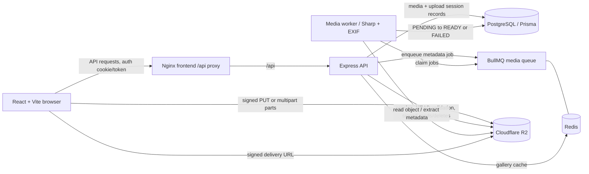

# mediaSaver

mediaSaver is a private image and video library. Users can upload media to Cloudflare R2, browse their own gallery, view and download originals, edit titles, and delete stored items. The browser sends files directly to R2 with short-lived upload URLs; the Express API owns authentication, authorization, metadata, and upload-session state.

## Working features

- Account registration, login, short-lived access tokens, HTTP-only refresh cookies, and password reset email flow.
- Private per-user media gallery with cursor pagination, image previews, title editing, and original downloads.
- Signed single-object uploads and resumable multipart R2 uploads (10 MiB parts, up to 50 GB); multipart progress/session data can resume in the browser.
- PostgreSQL media records and multipart session tracking through Prisma migrations.
- BullMQ metadata jobs on Redis. Images get dimensions and available EXIF capture time/location; videos are marked ready without image metadata extraction.
- Retry of transient processing failures (three attempts with exponential backoff), permanent failure handling, and idempotent job processing.
- Private image variants generated with Sharp, stored in R2 and reused; deletion removes variants, source object, and database row.
- Ownership checks, auth/upload rate limits, gallery cache invalidation, and optional Sentry reporting.

## Architecture



Compose runs the frontend, backend, worker, migration job, PostgreSQL, and Redis. For upload/download functionality, configure a real R2 bucket and its CORS policy for the frontend origin (`PUT`, `Content-Type`, and exposed `ETag`). See [RELEASE_VERIFICATION.md](RELEASE_VERIFICATION.md) for the tested lifecycle and its limits.

## Run locally

Prerequisites: Node.js compatible with the project dependencies, PostgreSQL, Redis, and a Cloudflare R2 bucket for real media operations. The commands below assume PowerShell and that you start from the repository root.

1. Install dependencies:

   ```powershell
   Push-Location BE; npm ci; Pop-Location
   Push-Location FE; npm ci; Pop-Location
   ```

2. Copy `BE/.env.example` to `BE/.env`. Set local PostgreSQL and Redis URLs, unique JWT secrets, and R2 credentials. The example's email values are placeholders; configure Gmail App Password credentials to test password reset. Never commit `.env` files.

3. Create the local database and apply migrations:

   ```powershell
   Push-Location BE
   npm run prisma:deploy
   Pop-Location
   ```

4. Start API and worker in separate terminals, then start the frontend:

   Run each command in a separate terminal opened at the repository root:

   ```powershell
   # Terminal 1: API
   Push-Location BE
   npm run dev

   # Terminal 2: worker
   Push-Location BE
   npm run worker

   # Terminal 3: frontend
   Push-Location FE
   npm run dev
   ```

   Open `http://localhost:5173`. The local frontend calls the API at `http://localhost:5000`; ensure `CLIENT_ORIGIN` in `BE/.env` is `http://localhost:5173`.

## Run with Docker Compose

The root Compose setup is the easiest way to run PostgreSQL and Redis with the app. Copy the example environment, set local secrets and real R2 credentials for media operations, then start the stack:

```powershell
Copy-Item .env.example .env
docker compose up --build -d
```

Open `http://localhost:8080`; health is at `http://localhost:8080/api/health`. Compose waits for database/Redis health, applies checked-in migrations, then starts the API, worker, and Nginx frontend. Check `docker compose ps` and `docker compose logs migrate backend worker frontend`. `docker compose down` preserves named database and Redis volumes. `docker compose down --volumes` removes those local volumes.

Compose R2 CORS must allow the frontend origin, `PUT`, `Content-Type`, and expose `ETag`. Password reset needs Gmail App Password settings and `CLIENT_URL` must match the browser origin. Keep secrets out of frontend `VITE_*` values and image builds. See [.env.example](.env.example) for the full Compose configuration.

## Checks and evidence

Backend tests use Vitest/Supertest; the repository has 9 test files (2 unit and 7 integration). The two unit test files passed with 8 tests in the October 14, 2026 evidence snapshot; the full backend suite did not finish, so overall test status remains incomplete/unverified. Existing release notes record local Compose verification of startup, upload completion, worker recovery/retries, ownership, and one delete scenario. The full integration suite and deployed production behavior are not claimed as verified here. See [engineering evidence](ENGINEERING_EVIDENCE.md) for the exact checks run and limitations.

From the repository root, run the backend test suite and frontend production build:

```powershell
Push-Location BE
npm test
Pop-Location

Push-Location FE
npm run build
Pop-Location
```

Run `npm run lint` in `FE` only if the frontend's `package.json` defines a `lint` script.

## Backend internship project story

Three evidence-backed draft bullets:

- Built a multi-user media API with JWT access tokens, HTTP-only refresh cookies, and owner-scoped media access; added integration tests targeting ownership and auth edge cases.
- Implemented direct-to-R2 single and resumable multipart uploads (up to 50 GB), with server-validated completion and persisted upload sessions.
- Added Redis/BullMQ metadata processing with idempotent jobs, three-attempt exponential retries, permanent failure states, and Sharp-generated private image variants.

Interview walkthrough: a user selects a file; the frontend requests a signed upload or multipart session, then transfers bytes to R2. The API validates ownership and object metadata when completion is reported, writes a `PENDING` record, and enqueues a job. A separate worker reads the object, extracts supported metadata, and conditionally updates the row to `READY`. Redis-backed retries survive worker restarts; transient errors leave the row pending during retries, while exhausted or permanent failures become `FAILED`. Deletion removes variants and source storage before deleting the row; cross-user access is hidden as not found. Discuss the remaining distributed failure window between storage deletion and database deletion, which currently returns an error and requires retry/operational inspection.
long, unique `JWT_SECRET` and keep Cloudinary credentials server-only.
- Add rate limiting, monitoring, backups, and automated authorization tests.
 long, unique `JWT_SECRET` and keep Cloudinary credentials server-only.
- Add rate limiting, monitoring, backups, and automated authorization tests.
